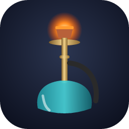
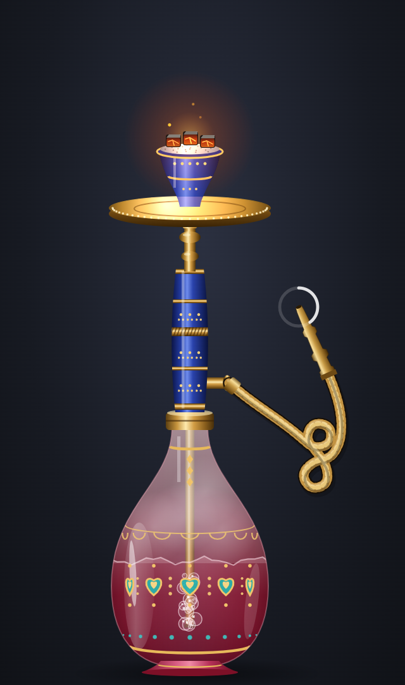
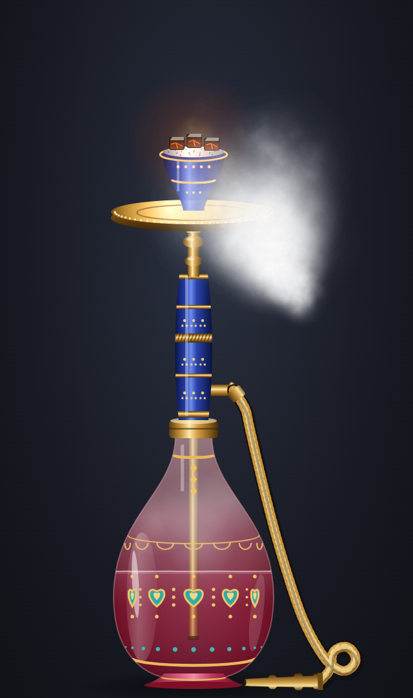

<div align="center">



# Desk Hookah

**A tiny floating hookah for your desktop. Grab the hose with your hand, pull, and blow out thick white smoke.**

[](https://github.com/Shuvashis-dev/desk-hookah/releases/latest)
[](LICENSE)


Created by **[Shuvashis Gautam](https://github.com/Shuvashis-dev)**


&nbsp;&nbsp;&nbsp;


</div>

---

Desk Hookah is a small, relaxing desktop toy that sits in the corner of your screen while you code, browse or think. Pull on the hose and the water bubbles, the coals glow brighter and the vase fills with smoke. Let go and a thick cloud rolls out. It's a fun break between tasks, and it stays out of your way the rest of the time.

No tobacco, no real smoke. Just pixels and good sound.

## Features

- **Pull it your way:** hold the mouthpiece with the mouse, hold <kbd>Space</kbd>, or use your webcam: make a fist to grab the hose, pull back to draw harder, open your hand to let go.
- **Real bubbling sound:** recorded bubbling that gets faster and brighter the harder you pull, plus a soft exhale.
- **Thick, adjustable smoke:** GPU-rendered clouds. Choose how much smoke comes out and how thick it is.
- **Smoke from your mouth:** switch on *My mouth* and a camera mirror appears above the hookah. Your exhale billows out of your mouth and follows your face.
- **Smoke rings (optional):** in *My mouth* mode, turn on rings and make an "O" while you exhale.
- **Little details:** glowing coals that flare and spark, rising bubbles, a braided hose with real rope physics that drops back beside the bottle.
- **Stays out of your way:** transparent and always on top, clicks pass through the empty space around it, no taskbar button, and it remembers where you put it.
- **Light on resources:** it draws at 60 fps only while something moves and drops to 5-8 fps when idle (about 1.5% of a 12-core CPU on the author's machine).
- **Private and offline:** camera frames are processed on your computer and never stored or sent anywhere. The app makes no network requests.

## Download

**Windows 10 and 11 (64-bit)**

1. Download `Desk Hookah_0.1.0_x64-setup.exe` from the [latest release](https://github.com/Shuvashis-dev/desk-hookah/releases/latest) (about 14 MB).
2. Run it. It installs for your user account only, so no admin rights are needed.
3. Desk Hookah appears in the bottom-right corner of your screen and in the system tray.

> **"Windows protected your PC"?** The installer isn't code-signed yet, so SmartScreen warns the first time. Click **More info**, then **Run anyway**.

The app needs Microsoft Edge WebView2, which comes with Windows 11 and most Windows 10 installs. If it's missing, the installer downloads it.

See [CHANGELOG.md](CHANGELOG.md) for what's in each release.

## How to use

| To... | Do this |
| --- | --- |
| Pull | Hold the mouthpiece with the mouse, hold <kbd>Space</kbd>, or make a fist in front of the camera |
| Pull harder | Drag the mouthpiece (or your fist) farther |
| Exhale | Let go, or open your hand |
| Move the hookah | Drag the hookah itself |
| Open settings | Right-click the hookah, or use the gear in the toolbar that appears on hover |
| Hide or show | Left-click the tray icon (right-click it for the full menu) |

**Hand control tips:** turn on *Hand control → Use camera* in settings. Keep your hand about an arm's length from the camera in decent light. A small ring shows where the app sees your hand, and it becomes an orange dot while you're holding the hose.

## Settings

The panel is short on purpose:

- **Smoke:** amount, thickness, where it comes from (mouthpiece or your mouth), and smoke rings.
- **Hand control:** use the camera, and grab with a fist or a pinch.
- **Window & sound:** size, volume, always on top, and battery saver (30 fps and lighter smoke).

## Privacy

- The camera is only used while *Hand control* or *My mouth* is on. Hiding the app to the tray releases it.
- Hand and face tracking run locally with [MediaPipe](https://ai.google.dev/edge/mediapipe) inside the app. No image is saved or uploaded.
- There are no accounts, analytics or network requests. Settings are stored locally on your computer.

## Build from source

You need:

- [Node.js](https://nodejs.org) 20 or newer
- [Rust](https://rustup.rs) (stable, MSVC toolchain)
- [Visual Studio Build Tools](https://visualstudio.microsoft.com/visual-cpp-build-tools/) with the "Desktop development with C++" workload
- Microsoft Edge WebView2 (already on Windows 11)

```bash
git clone https://github.com/Shuvashis-dev/desk-hookah.git
cd desk-hookah
npm install          # also fetches the MediaPipe runtime and models (about 12 MB)
npm run app:dev      # run the desktop app with live reload
npm run app:build    # build the installer into src-tauri/target/release/bundle/nsis
```

To work on the visuals in a normal browser, run `npm run dev` and open <http://localhost:1420/?demo>. Demo mode plays a pull and an exhale on a loop.

## How it works

| Part | Approach |
| --- | --- |
| Hookah | Canvas 2D. Static parts are pre-rendered once, so each frame only redraws water, bubbles, coals and the hose. |
| Hose | A Verlet rope with a weighted brass mouthpiece. It slides off the vase when released and sleeps when still. |
| Smoke | WebGL2: one instanced draw call of noise-textured puffs that rise, swirl, grow and fade. |
| Hand and mouth tracking | MediaPipe Hand Landmarker and Face Landmarker, filtered with a One Euro filter for smooth but responsive movement. |
| Sound | Web Audio: two looping bubble recordings with a seamless crossfade, plus a procedural exhale. |
| Desktop shell | Tauri 2 (Rust): transparent always-on-top window, tray menu, and click-through outside the hookah. |

```
desk-hookah/
├── index.html            Window markup, toolbar and settings panel
├── src/
│   ├── main.js           App loop: pulling, exhaling, input and settings
│   ├── scene.js          Hookah renderer
│   ├── hose.js           Rope physics for the hose
│   ├── smoke.js          WebGL smoke and smoke rings
│   ├── audio.js          Bubbling and exhale sound
│   ├── camera.js         Webcam, hand grab and mouth tracking
│   └── style.css         UI styles
├── src-tauri/            Rust desktop shell (window, tray, click-through)
├── public/audio/         Bubbling recordings (see THIRD_PARTY_NOTICES.md)
└── scripts/              Fetches the MediaPipe runtime and models on install
```

## Contributing

Issues and pull requests are welcome. If you build on this project, please keep the license and credit notices.

## Credits

Desk Hookah was created by **Shuvashis Gautam**: the idea, the design and the app.

It builds on [Tauri](https://tauri.app), [Vite](https://vite.dev) and Google's [MediaPipe](https://ai.google.dev/edge/mediapipe). The bubbling sounds come from Pixabay. Full details are in [THIRD_PARTY_NOTICES.md](THIRD_PARTY_NOTICES.md).

## Disclaimer

Desk Hookah is a novelty desktop toy made for fun. It doesn't sell, advertise or encourage the use of tobacco products and isn't affiliated with any hookah brand.

## License

[MIT](LICENSE) © 2026 Shuvashis Gautam. The bubbling sounds and the MediaPipe models are covered by their own licenses, listed in [THIRD_PARTY_NOTICES.md](THIRD_PARTY_NOTICES.md).
